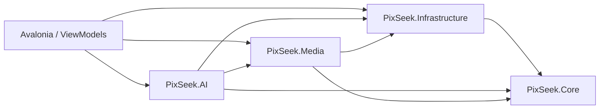

# Architecture

Le projet Avalonia existant est conservé. La solution desktop contient l'UI, le lanceur, quatre bibliothèques et les tests. Aucune bibliothèque métier ne dépend d'Avalonia. DI et logging sont configurés dans `PixSeek/Services/AppServices.cs`.

## Contrats

- `IEmbeddingService` : encodeurs image/texte, tableaux float normalisés.
- `IVectorSearchService` : recherche cosine ; `LibraryDatabase` utilise une table virtuelle `vec0`.
- `IMediaEncoder` : demande, progression, résultat vérifié.
- `IPlatformPaths` : stockage applicatif et répertoire natif par RID.
- `IExecutionProviderFactory` : options de sessions ONNX ; CPU implémenté et toujours disponible si les bibliothèques natives sont compatibles.

`LibraryDatabase` centralise ici schéma et accès aux données. SQLite est ouvert par opération, poolé, avec clés étrangères, WAL et délai de verrouillage. `SchemaMigration` contient la migration 1, idempotente. Les colonnes structurées servent aux filtres/index et `Payload` à la sérialisation des propriétés complémentaires. `MediaEmbedding` conserve le vecteur BLOB et son lien au média/frame. `MediaVector` contient les mêmes vecteurs dans sqlite-vec ; une transaction garantit la cohérence lors du remplacement.

La version de l'index comprend la révision du modèle et celle du prétraitement. Le changement de modèle/dimension détruit l'ancien index et invalide les versions des médias. Le modèle sélectionné produit 512 dimensions, l'implémentation SQL reçoit cette dimension du manifeste, elle ne la suppose pas pour toutes les familles.

## Indexation

La découverte construit d'abord un plan de travail avec une phase de préparation indéterminée, puis un `Channel<PlannedMedia>` borné à 32 transmet les médias au consommateur. Le pourcentage est pondéré par les étapes nécessaires (métadonnées, miniature, inférence, frames vidéo et persistance), avec un dénominateur fixe sur tous les dossiers. Les fichiers déjà indexés ne gonflent pas ce dénominateur. Un consommateur limite les processus de décodage et les inférences. Le scan passe hors thread UI. Les sessions ONNX sont partagées et protégées par un sémaphore. Les miniatures sont écrites dans le cache avec une clé SHA-256 de chemin, taille, modification et version. Le résultat est persisté média par média ; `Rescanner` reprend les éléments non indexés après fermeture.

Un fichier inchangé, dont le cache et la version d'embedding correspondent, est ignoré. Un fichier modifié invalide ses anciens vecteurs. Un média supprimé est marqué absent après scan complet, ses références sont conservées. Un dossier déconnecté est marqué indisponible sans suppression. Les déplacements sont actuellement traités comme disparition + nouveau chemin, pas comme identité conservée.

Les vidéos produisent des frames réparties sur la durée, à environ 10 secondes par défaut, avec plafond. Les frames sont persistées avec timestamp et vectorisées dans le même espace. Le KNN récupère davantage de voisins que de résultats souhaités, déduplique les vidéos et conserve leur meilleure scène. Il ne constitue pas une recherche exhaustive de toutes les scènes de chaque vidéo.

## Galerie

240 fiches maximum par page SQL, tri borné à une liste autorisée. `MediaGallery` dérive de `ListBox` avec des conteneurs de ligne non sélectionnables ; `VirtualizingStackPanel` virtualise les lignes. Chaque ligne contient un `ItemsControl` de 2 à 7 cartes selon la largeur ; cet ensemble est de taille bornée. Seuls les médias ont une sélection individuelle. `AsyncThumbnail` décode au maximum trois JPEG de cache en parallèle et libère chaque bitmap au détachement. Les originaux ne sont pas chargés pour composer la grille. Une visionneuse séparée prépare un aperçu de 3 200 pixels maximum.

La photothèque est la page initiale. Recherche et filtres partagent la même grille ; les changements de type/dossier/date s'appliquent après un délai de 150 ms. Les dates filtrent le jour local, fin incluse. Pendant un scan, un rafraîchissement discret réutilise les ViewModels par identifiant et modifie les lignes/cartes individuellement, sans `Clear` ni rechargement des miniatures inchangées. La page, la recherche, les filtres et les sélections sont conservés.

## Compression et jobs

`CompressionProfileResolver` produit une commande structurée ; `ProcessRunner` utilise `ArgumentList`, lit les deux pipes en parallèle, borne les logs en mémoire et tue l'arbre de processus sur annulation/timeout. FFmpeg publie `out_time_us`. La pause est coopérative entre médias, sans suspension arbitraire d'un encodeur natif.

`CompressionDialogView` est superposé dans le `MainView`, avec arrière-plan désactivé et focus contenu dans le panneau. Le ViewModel configure une source dossier ou une sélection, une destination, trois modes simples et les paramètres avancés.

`MediaEncoder` écrit un fichier temporaire unique dans la destination. `CompressionVerificationService` valide la sortie avant un `File.Move` sans écrasement. Le gain affiché résulte des tailles réelles. `CompressionJob` et `CompressionItem` enregistrent le journal. Une relance du même dossier, de la même destination, de la même sélection et des mêmes options retrouve un travail interrompu ; une sortie déjà validée doit encore correspondre à sa taille et sa date source pour être réutilisée. Les destinations personnalisées sont exclues des scans récursifs ultérieurs. Aucun job ne supprime un original.

Le système de jobs est volontairement petit : scan/indexation et conversion ont chacun leur contrôle de pause/annulation ; les étapes de scan sont persistées par statut média. Une orchestration générique durable de chaque sous-étape reste à développer.

## Mobile futur

Réutiliser Core et les contrats, remplacer les implémentations de chemins, base, sélection, lecture et traitement natif. Ne pas copier les processus FFmpeg/ImageMagick desktop sur Android/iOS. Les ViewModels actuels sont desktop et leur navigation devra être adaptée.
