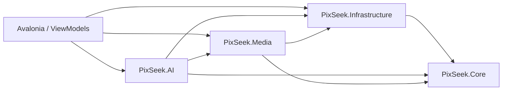

# Architecture

Le projet Avalonia existant est conservé. La solution desktop contient l'UI, le lanceur, quatre bibliothèques et les tests. Aucune bibliothèque métier ne dépend d'Avalonia. DI et logging sont configurés dans `PixSeek/Services/AppServices.cs`.

## Contrats

- `IEmbeddingService` : encodeurs image/texte, tableaux float normalisés.
- `IVectorSearchService` : recherche cosine ; `LibraryDatabase` utilise une table virtuelle `vec0`.
- `IMediaEncoder` : demande, progression, résultat vérifié.
- `IPlatformPaths` : stockage applicatif et répertoire natif par RID.
- `IExecutionProviderFactory` : options de sessions ONNX ; CPU implémenté et toujours disponible si les bibliothèques natives sont compatibles.

`LibraryDatabase` centralise ici schéma et accès aux données dans `<données>/pixseek.db`. SQLite est ouvert par opération, poolé, avec clés étrangères, WAL et délai de verrouillage. `SchemaMigration` contient les migrations versionnées 1 et 2. La migration 2 répare les colonnes de filtrage des anciennes bases PixSeek depuis les fiches JSON. Les colonnes structurées servent aux filtres/index et `Payload` à la sérialisation des propriétés complémentaires. `MediaEmbedding` conserve le vecteur BLOB et son lien au média/frame. `MediaVector` contient les mêmes vecteurs dans sqlite-vec ; une transaction garantit la cohérence lors du remplacement.

Les poids ne dépendent pas des données utilisateur : `PlatformPaths.Models` désigne exclusivement `<exécutable>/models`. Le build desktop prépare XLM-R/ViT-B/32 et YuNet/SFace via `build/ModelAssets.targets`, à partir des manifestes épinglés. La tâche de build est un petit projet SDK sans paquet externe. Les fichiers valides sont réutilisés, les téléchargements utilisent un fichier temporaire et une validation taille/SHA-256 avant renommage ; seuls les actifs des manifestes sont copiés dans la sortie. SigLIP2 est préparé en plus pour les tests, mais reste optionnel dans l'application publiée.

La version de l'index comprend la révision du modèle et celle du prétraitement. Le changement de modèle/dimension détruit l'ancien index et invalide les versions des médias. Le modèle sélectionné produit 512 dimensions, l'implémentation SQL reçoit cette dimension du manifeste, elle ne la suppose pas pour toutes les familles.

## Indexation

La découverte construit d'abord un plan de travail avec une phase de préparation indéterminée, puis jusqu'à trois workers préparent les métadonnées et miniatures. Un Channel de références transmet les médias prêts au worker ONNX, indépendamment de la cadence des miniatures. Le pourcentage est pondéré par les étapes nécessaires (métadonnées, miniature, inférence, frames vidéo et persistance), avec un dénominateur fixe sur tous les dossiers. Les fichiers déjà indexés ne gonflent pas ce dénominateur. Le nombre de processus de préparation est borné ; les inférences sont sérialisées, avec parallélisme CPU interne ONNX. Le scan passe hors thread UI. Les sessions ONNX sont partagées et protégées par un sémaphore. Les miniatures sont écrites dans le cache avec une clé SHA-256 de chemin, taille, modification et version. Le résultat est persisté média par média ; `Rescanner` reprend les éléments non indexés après fermeture.

Un fichier inchangé, dont le cache et la version d'embedding correspondent, est ignoré. Un fichier modifié invalide ses anciens vecteurs. Un média supprimé est marqué absent après scan complet, ses références sont conservées. Un dossier déconnecté est marqué indisponible sans suppression. Les déplacements sont actuellement traités comme disparition + nouveau chemin, pas comme identité conservée.

Les vidéos produisent des frames réparties sur la durée, à environ 10 secondes par défaut, avec plafond. Les frames sont persistées avec timestamp et vectorisées dans le même espace. Le KNN récupère davantage de voisins que de résultats souhaités, déduplique les vidéos et conserve leur meilleure scène. Il ne constitue pas une recherche exhaustive de toutes les scènes de chaque vidéo.

## Galerie

Lots SQL de 240 fiches ajoutés au défilement ; tri et filtres appliqués à toute la bibliothèque avant LIMIT/OFFSET. `MediaGallery` dérive de `ListBox` avec des conteneurs de ligne non sélectionnables ; `VirtualizingStackPanel` virtualise les lignes. Chaque ligne contient un `ItemsControl` de 2 à 7 cartes selon la largeur ; le nombre de colonnes explicite conserve la largeur des cases sur une ligne incomplète. Seuls les médias ont une sélection individuelle. `AsyncThumbnail` décode au maximum trois JPEG de cache en parallèle et libère chaque bitmap au détachement. Les originaux ne sont pas chargés pour composer la grille. La visionneuse est superposée dans la même fenêtre. ImagePreviewCache décode directement via SKCodec, applique EXIF et conserve trois images avec leases ; le préchargement utilise le même cache. Les formats non reconnus utilisent un JPEG de secours persistant.

La photothèque est la page initiale. Recherche et filtres partagent la même grille ; les changements de type/dossier s'appliquent après un délai de 150 ms. Le premier élément du filtre dossier représente explicitement tous les dossiers. Pendant un scan, un rafraîchissement discret réutilise les ViewModels par identifiant et modifie les lignes/cartes individuellement, sans `Clear` ni rechargement des miniatures inchangées. La page, la recherche, les filtres et les sélections sont conservés.

## Compression et jobs

`CompressionProfileResolver` produit une commande structurée ; `ProcessRunner` utilise `ArgumentList`, lit les deux pipes en parallèle, borne les logs en mémoire et tue l'arbre de processus sur annulation/timeout. FFmpeg publie `out_time_us`. La pause est coopérative entre médias, sans suspension arbitraire d'un encodeur natif.

`CompressionDialogView` est superposé dans le `MainView`, avec arrière-plan désactivé et focus contenu dans le panneau. Le ViewModel configure une source dossier ou une sélection, une destination, trois modes simples et les paramètres avancés.

`MediaEncoder` écrit un fichier temporaire unique dans la destination. `CompressionVerificationService` valide la sortie avant un `File.Move` sans écrasement. Le gain affiché résulte des tailles réelles. `CompressionJob` et `CompressionItem` enregistrent le journal. Une relance du même dossier, de la même destination, de la même sélection et des mêmes options retrouve un travail interrompu ; une sortie déjà validée doit encore correspondre à sa taille et sa date source pour être réutilisée. Les destinations personnalisées sont exclues des scans récursifs ultérieurs. Aucun job ne supprime un original.

Le système de jobs est volontairement petit : scan/indexation et conversion ont chacun leur contrôle de pause/annulation ; les étapes de scan sont persistées par statut média. Une orchestration générique durable de chaque sous-étape reste à développer.

## Mobile futur

Réutiliser Core et les contrats, remplacer les implémentations de chemins, base, sélection, lecture et traitement natif. Ne pas copier les processus FFmpeg/ImageMagick desktop sur Android/iOS. Les ViewModels actuels sont desktop et leur navigation devra être adaptée.

## Recherche, modèles et surveillance (0.2.0)

HybridRanking conserve l'ordre cosine si la vraisemblance du nom est faible. Un nom normalisé exact, une expression complète ou une distance d'édition normalisée ≥ 0,84 reçoit une priorité forte. Les candidats par nom sont obtenus indépendamment du top K sémantique, puis fusionnés par identifiant.

ModelManager sélectionne un manifeste XLM-R ou SigLIP2. Le tokenizer, padding, longueur, normalisation et resize sont propres au modèle. Le changement attend l'arrêt du scan, libère les sessions ONNX, valide le nouveau modèle, reconstruit vec0 avec ses dimensions, persiste le choix puis réindexe automatiquement. Le choix visuel est immédiat ; le chargement est sérialisé hors du thread UI et la dernière demande est prioritaire. La recherche est suspendue pendant le remplacement des sessions et de l'index, puis redevient disponible pendant la réindexation en arrière-plan.

LibraryMonitor combine un signal FileSystemWatcher temporisé de 750 ms et une réconciliation périodique d'une minute. Le scan initial réconcilie également les dossiers. Un travail unique traite les signaux groupés ; les disques absents ne sont pas purgés.

EmbeddedVideoSession utilise les callbacks RV32 de LibVLC et une WriteableBitmap Avalonia. Une seule copie de frame est en attente sur le dispatcher ; le buffer natif est verrouillé durant la copie. Aucun NativeControlHost ni fenêtre vidéo séparée n'est créé. L'arrêt attend le player avant de libérer le buffer.

TranslationService charge un JSON par langue ; l'extension XAML T lie les textes au changement de langue. Les identifiants des choix restent stables. Les paramètres sont écrits atomiquement après 250 ms, sans perdre les préférences de compression ; la fermeture attend la sauvegarde en attente.

Depuis 0.2.1, les filtres sont poussés dans vec0 par rowid IN (sous-requête MediaEmbedding/MediaFile), avant MATCH/k. ICompressionCodecPolicy centralise les codecs de défaut. FFprobe détermine la taille d'affichage vidéo avec rotation et SAR ; EndReached gère une position finale stable et la recréation du média lors du replay.

## Personnes et interactions 0.3.0

FaceEmbeddingService exécute YuNet/SFace dans des sessions ONNX séparées. PeopleRepository crée les tables Person, PersonAlias, PersonReference, FaceScan, FaceObservation et FaceVector (vec0 128D). FaceLibraryIndexer réutilise les signatures et analyse les photos en arrière-plan. PeopleViewModel pilote le panneau de références et le worker ; LibraryViewModel préfixe les résultats hybrides avec les correspondances faciales des alias présents dans la requête. La fermeture attend les tâches de références/indexation avant de libérer les sessions. Les détails mathématiques et licences sont dans PEOPLE.md.

MediaClipboard expose un fichier original et, pour une photo, un bitmap détaché du cache. Le transfert implémente IDataTransfer/IAsyncDataTransfer et possède la durée de vie du bitmap. Les flèches couvrent les deux lignes de la visionneuse ; le timestamp initial est séparé de la navigation. Le retour en haut est un événement de vue explicite, indépendant du rafraîchissement de fond.

## Ouverture et indexation 0.3.1

ImagePreviewCache sépare le verrou très court de ses traitements de décodage. Un dictionnaire de tâches fusionne les demandes du même fichier ; deux sémaphores distincts réservent un worker à l'ouverture et un au préchargement. Les références des demandeurs sont réservées avant la fin du décodage pour empêcher une éviction prématurée. Annuler un demandeur ne détruit pas le bitmap d'un autre ; vider le cache change sa génération, de sorte qu'un ancien décodage ne puisse pas le remplir à nouveau. Les leases restent valides après éviction ou vidage.

ImagePreviewDecoder (contrat IImagePreviewDecoder) utilise Skia et évite la surface d'orientation intermédiaire pour une image déjà orientée. Le résultat est réellement borné à 4096 pixels même si GetScaledDimensions ne réduit pas un PNG. Au-delà de 64 mégapixels, le décodage direct cède à ImageMagick et son aperçu disque persistant. Il n'y a pas de garantie de temps pour un premier décodage rare ou un support lent.

VideoRuntime partage l'instance LibVLC et borne le nombre de players simultanément créés à deux. L'ancien player s'arrête pendant la préparation du nouveau média, hors UI. La taille d'affichage (rotation/SAR appliqués) est persistée dans le payload MediaFile lors de l'import et validée par taille/date à l'ouverture ; les anciens enregistrements sont rattrapés au scan. Les métadonnées de repli de la visionneuse ont un cache mémoire borné et un délai de 10 s. Les vérifications de compression continuent d'utiliser un FFprobe frais.

Le worker facial ne dépend plus de l'existence d'un profil. PhotoPrepared signale des photos disponibles ; MainViewModel regroupe les signaux sur son horloge, sans attendre la fin des inférences sémantiques. Les signatures persistées assurent la reprise. La grille est rafraîchie pendant chacun des deux indexeurs. La suppression d'un profil supprime ses références, tout en conservant les observations de visages sans profil de la bibliothèque.
